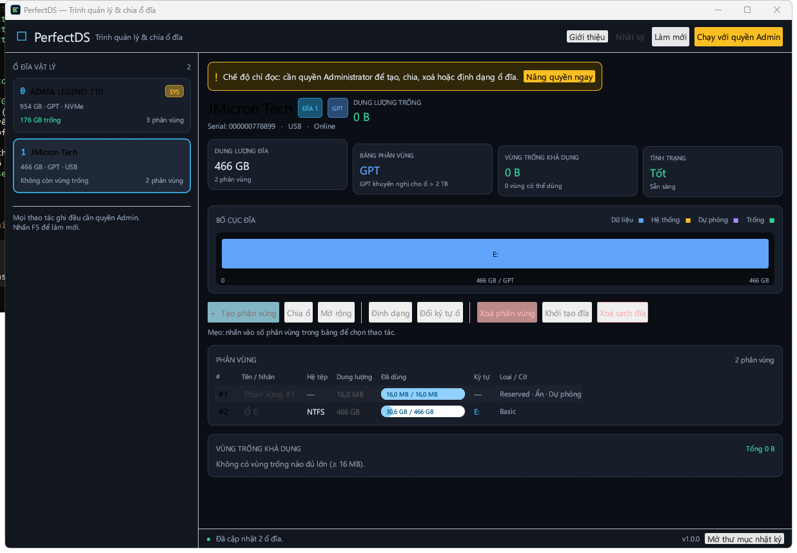

# PerfectDS — Trình quản lý & chia ổ đĩa cho Windows

PerfectDS là ứng dụng desktop bằng tiếng Việt giúp **xem bố cục ổ đĩa, tạo / chia / mở rộng / xoá / định dạng phân vùng** trực tiếp trên Windows. Giao diện dùng [egui/eframe](https://github.com/emilk/egui), toàn bộ thao tác ghi đĩa đi qua **Windows Storage API** — cùng lớp mà Disk Management của Windows sử dụng — nên việc thu nhỏ NTFS, tạo phân vùng, định dạng… được Windows xử lý an toàn.



## Tính năng

- **Xem chi tiết đĩa**: tên, serial, bus (NVMe/SATA/USB), bảng phân vùng GPT/MBR/RAW, tình trạng sức khoẻ, dung lượng, vùng trống.
- **Bản đồ đĩa trực quan**: phân vùng, vùng dự phòng, vùng trống, rê chuột để xem chi tiết, nhấn để chọn phân vùng.
- **Tạo phân vùng mới** trong vùng trống (NTFS / exFAT / FAT32), gán ký tự ổ và nhãn.
- **Chia ổ**: thu nhỏ phân vùng NTFS/ReFS rồi tạo phân vùng mới ngay sau đó, có tự động hoàn tác nếu bước tạo/định dạng thất bại.
- **Mở rộng phân vùng** khi có vùng trống liền kề (Windows `Resize-Partition`).
- **Xoá phân vùng**, **định dạng** (nhanh hoặc đầy đủ), **đổi ký tự ổ**.
- **Khởi tạo đĩa GPT** cho đĩa RAW và **xoá sạch toàn bộ đĩa**.
- **Bảo vệ an toàn**: chặn phân vùng Boot/System/Reserved, phát hiện BitLocker, yêu cầu quyền Administrator, xác nhận bằng từ khoá cho thao tác nguy hiểm, ghi nhật ký mọi thao tác.
- **Giao diện tối, font hệ thống** hiển thị đầy đủ dấu tiếng Việt; icon riêng cho cửa sổ và file EXE.
- **CLI nâng cao** (`dpm-cli.exe`) giữ tương thích các lệnh cũ: `inspect`, `plan-move`.

## Yêu cầu

- Windows 10/11 (64-bit).
- Quyền **Administrator** để thực hiện bất kỳ thao tác ghi nào (tạo, chia, xoá, định dạng, đổi ký tự, khởi tạo, xoá sạch).
- Không cần cài .NET hay Visual C++ Redistributable — CRT đã được liên kết tĩnh vào EXE.

Khi mở ứng dụng ở chế độ thường, PerfectDS vẫn xem được thông tin đĩa nhưng các nút thao tác sẽ bị khoá. Nhấn **“Chạy với quyền Admin”** (hoặc chuột phải EXE → *Run as administrator*) để mở lại với quyền quản trị.

## Cách dùng nhanh

1. Mở `PerfectDS.exe` (nên chạy bằng quyền Administrator).
2. Chọn ổ đĩa ở cột bên trái. Ổ chứa Windows được đánh dấu **SYS** và luôn được bảo vệ.
3. Chọn phân vùng trong bảng (hoặc nhấn vào thanh bản đồ đĩa).
4. Dùng thanh công cụ:
   - **Tạo phân vùng** — chọn vùng trống, dung lượng, hệ tệp, ký tự ổ.
   - **Chia ổ** — chọn phân vùng NTFS/ReFS, nhập dung lượng ổ mới; phần còn lại được giữ nguyên.
   - **Mở rộng** — chỉ khả dụng khi ngay sau phân vùng là vùng trống.
   - **Định dạng / Đổi ký tự / Xoá phân vùng**.
   - **Khởi tạo đĩa** (đĩa RAW) và **Xoá sạch đĩa**.
5. Với thao tác nguy hiểm, gõ đúng từ khoá được yêu cầu (`DELETE`, `FORMAT`, `ERASE`, `INIT`) để xác nhận.
6. Nhấn **Làm mới** (hoặc F5) để cập nhật trạng thái sau khi thao tác.

Nhật ký thao tác: `%LOCALAPPDATA%\PerfectDS\operations.log` — có thể mở trực tiếp từ thanh trạng thái.

## Cảnh báo quan trọng

> **Hãy sao lưu dữ liệu quan trọng trước khi chia ổ, định dạng hoặc xoá phân vùng.**
> Các thao tác này có thể làm mất dữ liệu vĩnh viễn và không thể hoàn tác.

- Không rút USB / tắt nguồn trong khi đang thu nhỏ, mở rộng hoặc định dạng.
- Phân vùng hệ thống/khởi động/dự phòng của Windows bị chặn tự động.
- Phân vùng BitLocker: PerfectDS phát hiện và **không cho chia/mở rộng/định dạng** khi BitLocker đang bật. Hãy tắt hoặc suspend BitLocker trước.
- Thu nhỏ chỉ hỗ trợ NTFS/ReFS; Windows có thể giới hạn mức thu nhỏ tuỳ dữ liệu và các file không di chuyển được (pagefile, file hệ thống, ảnh snapshot…).
- Mở rộng chỉ thực hiện được khi vùng trống nằm **liền ngay sau** phân vùng.
- Với đĩa đang chứa Windows, hãy đặc biệt cẩn thận khi tạo phân vùng mới trong vùng trống.

## Build từ mã nguồn

Cần Rust stable (MSVC toolchain) và Windows SDK. Nếu có `rc.exe` trong Windows SDK, icon và thông tin phiên bản sẽ được nhúng vào EXE; nếu không, build vẫn thành công (chỉ thiếu icon/version resource).

```powershell
cd disk_partition_mgr
cargo test
cargo build --release
```

Kết quả:

```
disk_partition_mgr\target\release\perfectds.exe   # giao diện GUI
disk_partition_mgr\target\release\dpm-cli.exe      # dòng lệnh
```

Đóng gói bản phát hành:

```powershell
# Từ thư mục gốc dự án
New-Item -ItemType Directory -Force dist | Out-Null
Copy-Item disk_partition_mgr\target\release\perfectds.exe dist\PerfectDS.exe -Force
Copy-Item disk_partition_mgr\target\release\dpm-cli.exe dist\dpm-cli.exe -Force
```

## CLI (`dpm-cli.exe`)

Giữ tương thích với công cụ cũ, dùng cho chẩn đoán và kịch bản nâng cao:

```powershell
dpm-cli.exe inspect
dpm-cli.exe inspect --disk \\.\PhysicalDrive1
dpm-cli.exe inspect --disk \\?\C:\test\disk.vhd

dpm-cli.exe plan-move --disk \\.\PhysicalDrive1 --partition 2 --direction right --offset-sectors 16 --dry-run
dpm-cli.exe plan-move --disk \\.\PhysicalDrive1 --partition 2 --direction right --offset-sectors 16 --apply
```

- `plan-move` mặc định là **dry-run**; chỉ ghi đĩa khi có `--apply`.
- Đọc/ghi đĩa vật lý cần quyền Administrator.
- `plan-move --apply` sao chép dữ liệu phân vùng theo từng bước và kiểm tra va chạm trước khi ghi — đây là tính năng nâng cao, chỉ dùng khi đã hiểu rõ rủi ro.

## Cấu trúc mã nguồn

```
disk_partition_mgr/
├─ build.rs              # nhúng icon vào EXE (nếu có rc.exe)
├─ assets/               # icon PNG/ICO/RGBA
└─ src/
   ├─ bin/perfectds.rs   # entry GUI
   ├─ bin/dpm-cli.rs     # entry CLI
   ├─ gui/               # giao diện egui (app.rs, theme.rs)
   ├─ ops.rs             # thao tác đĩa + kiểm tra an toàn + script PowerShell
   ├─ model.rs           # mô hình dữ liệu đĩa/phân vùng
   ├─ sys.rs             # admin, PowerShell ẩn, log, hộp thoại
   ├─ cli.rs             # lệnh inspect / plan-move
   ├─ disk_info.rs       # đọc bảng phân vùng MBR/GPT qua IOCTL
   └─ planner.rs         # lập kế hoạch dời phân vùng (CLI nâng cao)
```

## Giấy phép

Dự án cá nhân, sử dụng nội bộ. Hãy kiểm tra lại quyền của các thư viện phụ thuộc (egui/eframe: MIT hoặc Apache-2.0) nếu phát hành rộng rãi.
